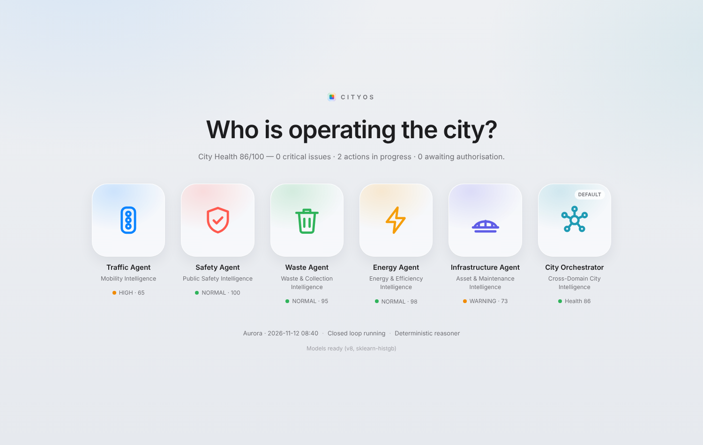

# CityOS: Autonomous Agentic AI for Smart Cities & Intelligent Infrastructure

CityOS is an autonomous city-operations agent for traffic, safety, waste, energy and infrastructure. It isn't a chatbot
and it isn't a dashboard. It runs a closed loop:

**OBSERVE → UNDERSTAND → ANALYZE → DETECT → INVESTIGATE → PREDICT → PLAN → DECIDE → ACT → VERIFY → ADAPT → REPEAT**

The loop runs against a live digital twin of **Patiala, Punjab**: six zones named after real areas (Thapar
University & Bhadson Road, Old City · Qila Mubarak, Leela Bhawan & Mall Road, Tripuri & Model Town, Civil Lines ·
Mini Secretariat, Focal Point Industrial Area), Badi Nadi as the river, Patiala's monthly climate normals, and costs in
rupees. The layout is a **schematic grid** with real place and road names, not Patiala's true street geometry. It
has 24 signalised intersections, 35 roads and 3 river bridges, 24 smart bins, 12 metered buildings, solar, battery and EV hubs, 25 monitored
infrastructure assets, emergency units and maintenance crews. Sensors change continuously. The ML models forecast,
domain agents detect and plan, and the City Orchestrator coordinates them, checks safety, acts **in simulation**,
and verifies each action against a no-action counterfactual twin.

> Every action runs in the simulated digital twin. No physical system is connected, and the UI and logs say
> `SIMULATED` on every action. High-impact actions (emergency dispatch, signal pre-emption, precautionary
> closures, unit deployment) always wait for human authorisation.



---

## Quick start

```bash
python -m venv .venv && source .venv/bin/activate      # Windows: .venv\Scripts\activate
pip install -r requirements.txt
python main.py                                         # or: uvicorn main:app --port 8000
```

Open **http://localhost:8000**. On the first start CityOS generates 14 days of synthetic history in `data/*.csv`
and trains the models in `models/*.pkl`. This takes about 20 s. Later starts load the saved models.

* API docs: http://localhost:8000/docs
* Headless tests: `python tests/test_engine.py` (or `pytest -q tests`)
* Docker: `docker compose up --build`

### Optional: LLM reasoning
Copy `.env.example` to `.env` and set a provider. Keys are read only from `.env`.

```ini
LLM_PROVIDER=anthropic          # or openai | openai_compatible
LLM_MODEL=claude-sonnet-5-5     # any model id your provider offers
LLM_API_KEY=...
# openai_compatible (e.g. a local model server): LLM_BASE_URL=http://localhost:11434
```

Without a key, a deterministic decision engine makes every decision and the UI says so.

---

## What you'll see

**Entry screen ("CITYOS — Who is operating the city?")**: choose Traffic, Safety, Waste, Energy,
Infrastructure, or the City Orchestrator (the default cross-domain mode). Each profile shows its live state.

**Agent workspace**: the selected domain becomes the primary context:

| Agent | Tabs |
|---|---|
| Traffic | Live Traffic · Predictions · Incidents · Actions |
| Safety | Zones · Incidents · Coverage · Actions |
| Waste | Bins · Forecasts · Collection · Actions |
| Energy | Demand · Buildings · Forecasts · Optimization |
| Infrastructure | Assets · Maintenance · Risk · Actions |
| City Orchestrator | Overview (explainable City Health) · Coordination · What-if · Learning |

Every workspace has a live SVG digital-twin map with domain-specific layers, plus three side panels:

* **Needs attention**: prioritised issues. Click one to see root causes, forecast, evidence and candidate actions.
* **Decisions & actions**: each action shows its AI rationale, safety validation and verification result.
* **Agent activity**: the phase-coded agent log.

The **Authorisation** button opens the human-approval queue. **1× / 2× / 4×** sets the simulation speed.

**Try it:**
1. Orchestrator → What-if → *Bridge closure* → **Inject live**. The Infrastructure Agent detects the closure, the
   Traffic Agent predicts congestion, Safety checks emergency routes and Waste checks collection routes. The
   Orchestrator then builds a coordinated plan (diversion + corridor signal retiming + …).
2. Inject *City festival*. Crowding escalates to WARNING or CRITICAL and crowd management is decided, acted on
   and verified.
3. Open **Authorisation** when an incident appears and authorise or reject the emergency dispatch.

---

## Architecture

```
Synthetic sensors / CSV / JSON / REST ─► Ingestion & processing ─► ML engine ─► Domain agents ─► City Orchestrator
                                                                                                │
         ┌──────────────────────────────────────────────────────────────────────────────────────┘
         ▼
   Priority engine ─► Decision engine (rules + optional LLM w/ tools) ─► Safety layer ─► Authorisation (HIGH)
         ─► Action engine (digital twin) ─► Verification (before / after / counterfactual) ─► Adaptation ─► repeat
```

| Module | Responsibility |
|---|---|
| `cityos/twin.py` | Digital twin and sensor simulator. Covers BPR link speeds, HCM/Webster intersection delay, signal plans and adaptive control, accidents, closures, diversion, crowds, bins and trucks, building loads (HVAC/lighting/plug), solar, battery, EV, asset degradation and fault progression, crews and units, and weather. Injects ground-truth anomalies and sensor faults. |
| `cityos/processing.py` | De-duplication, timestamp normalisation, unit conversion (mph→km/h, W→kW, °F→°C), range validation, imputation, stuck/dropout/uncorroborated-spike sensor detection, EWMA rolling stats, spatial aggregation. Also holds the configurable CSV/JSON/REST connectors and an optional Open-Meteo weather connector. |
| `cityos/ml.py` | Hour-of-day baselines (Z-score), rolling deviation and per-domain Isolation Forests. Gradient-boosted forecasters: traffic flow (15–120 min), energy demand and solar (1–24 h), bin fill trajectory and overflow time, crowding risk (1 h), infrastructure failure probability (24 h) and RUL. Feedback ledger with MAE/RMSE/MAPE and P/R/F1, bias correction and daily retraining. Uses XGBoost when installed. |
| `cityos/optimize.py` | Webster signal plans, k-shortest alternative paths weighted by spare capacity, emergency routing and pre-emption corridors, capacitated collection routing (OR-Tools when installed, else NN + 2-opt), battery dispatch LP (SciPy/HiGHS: cost + peak + carbon), maintenance priority (Risk × P(fail) × Impact × Criticality), counterfactual simulation, cost and carbon calculators. |
| `cityos/agents.py` | Traffic, Safety, Waste, Energy and Infrastructure agents. Each does observe → analyse → detect → investigate (ranked root causes) → predict → plan (candidate actions with tool-estimated impact). They exchange messages on a bus (road closures, congestion forecasts, emergency route impacts, collection delays, fire risk). |
| `cityos/orchestrator.py` | City state engine, priority engine (S×P×I×U, configurable thresholds), cross-domain coordinated plans, decision engine, safety layer, action engine, verification, adaptation, explainable City Health score, what-if simulator, and the tool registry exposed to the LLM. |
| `cityos/llm.py` | Provider-agnostic LLM client (Anthropic, OpenAI, OpenAI-compatible) with a tool-calling loop. Its decisions are validated against agent-generated candidates; fabricated proposal IDs are rejected. |
| `cityos/store.py` | SQLite: sensor_data, events, predictions, agent_log, actions, infrastructure, model_metrics. Swap in PostgreSQL / TimescaleDB / PostGIS for production. |
| `main.py` | FastAPI app, background closed loop, WebSocket push (polling fallback), all endpoints. |
| `frontend/` | Vanilla HTML/CSS/JS with Liquid-Glass-inspired styling, an SVG digital twin and dependency-free canvas charts. |

### How the LLM is constrained
The LLM handles reasoning, tool selection, prioritisation and explanation only. ML models and optimisers produce
all numbers, and the tools return them (`get_traffic_status`, `predict_congestion`, `predict_waste_overflow`,
`predict_energy_demand`, `predict_maintenance`, `optimize_route`, `optimize_signal_timing`, `optimize_resources`,
`calculate_cost`, `calculate_carbon`, `simulate_action`, `verify_action`, …). The LLM can only pick a proposal
that a domain agent generated. Its choice still passes the safety layer, and HIGH-risk actions still need a
human. Without an LLM, or when a call fails, the deterministic engine decides and is labelled as such.

### Verification
Before acting, the orchestrator clones the twin and runs it forward without the action, using the same random
stream. After the effect window it compares three values:

**before → after → counterfactual**

Results are SUCCESS, PARTIAL or FAILED. A FAILED action triggers INVESTIGATE → REPLAN with the remaining
alternatives.

### Adaptation
* Model bias correction from resolved predictions (prediction → outcome → error → update), plus daily retraining
  on history + live data
* Detection thresholds tuned from live precision/recall against injected ground truth
* Action-type effectiveness feeds back into action selection
* Monitoring frequency rises for escalated domains

---

## API

| Endpoint | Purpose |
|---|---|
| `GET /api/city/status` · `/api/city/snapshot` · `/api/city/twin` | City health and state; full live snapshot; twin geometry |
| `GET /api/traffic/current` · `/forecast` · `/incidents` | Traffic state, ML forecasts, collisions and closures |
| `GET /api/safety/status` · `/incidents` | Zone crowd levels, coverage, incidents |
| `GET /api/waste/current` · `/forecast` · `/bins` | Waste state, overflow forecasts, bins |
| `GET /api/energy/current` · `/forecast` | Grid, buildings, DER; 24 h forecast, cost, carbon |
| `GET /api/infrastructure/assets` · `/maintenance` | Assets; maintenance priority queue |
| `GET /api/agents/status` · `/decisions` · `/log` · `/messages` | Agents, decisions, activity log, bus |
| `GET /api/actions` · `/api/actions/{id}` · `/api/actions/{id}/verify` | Actions and verification |
| `POST /api/actions/{id}/approve` · `/reject` | Human authorisation |
| `GET/POST /api/city/simulation` · `POST /api/city/simulation/clear` | What-if (`mode: whatif` or `live`) |
| `GET /api/ml/metrics` · `/api/data/quality` · `/api/sensors/{entity}/{metric}` | Model metrics, pipeline stats, sensor history |
| `GET /api/tools` · `POST /api/tools/{name}` | Agent tools |
| `GET /api/reports/briefing` | Shift briefing (LLM if configured, otherwise deterministic) |
| `POST /api/city/control` · `WS /ws` | Pause / speed; live push |

---

## Changing the city
`CITY_NAME` and `CURRENCY` in `.env` set the labels. Zone, road and building names live in `cityos/twin.py`
(`_build`), and the climate profile in `Weather.MONTH_MEAN` / `RAIN_DAYS`. Delete `models/*.pkl` and `data/*.csv`
after changing the climate or loads so the models retrain.

## Extending to real systems
* **Data:** set `DATASET_CONNECTORS` (CSV/JSON/REST) with column mappings in `data/connectors.json` (see
  `connectors.example.json`). Map real feeds onto the record schema
  *timestamp + location + entity + measurement + status + source*.
* **Streaming:** the processor accepts batches of records, so an MQTT/Modbus consumer can call
  `Processor.process()` the same way the simulator does.
* **Actuation:** `Orchestrator.apply()` is the single place where actions take effect. Real adapters (traffic
  controller, fleet, BMS, CMMS, CAD) belong behind it, behind the safety layer and authorisation, and must report
  a real execution mode. Only authorised, access-controlled systems should be integrated.

## Known limitations (prototype)
* The city layout and all sensor data are synthetic (real Patiala names on a schematic grid), so models are trained on simulated history. Expect re-calibration on real data.
* The infrastructure failure classifier shows modest held-out precision and recall (~0.3). The Learning tab
  reports it honestly; it is the main candidate for better features and real maintenance records.
* Battery dispatch plans on a 24 h forecast, so large forecast errors (e.g. sudden demand scenarios) can leave it
  without energy at the true peak. Verification will report this as PARTIAL or FAILED.
